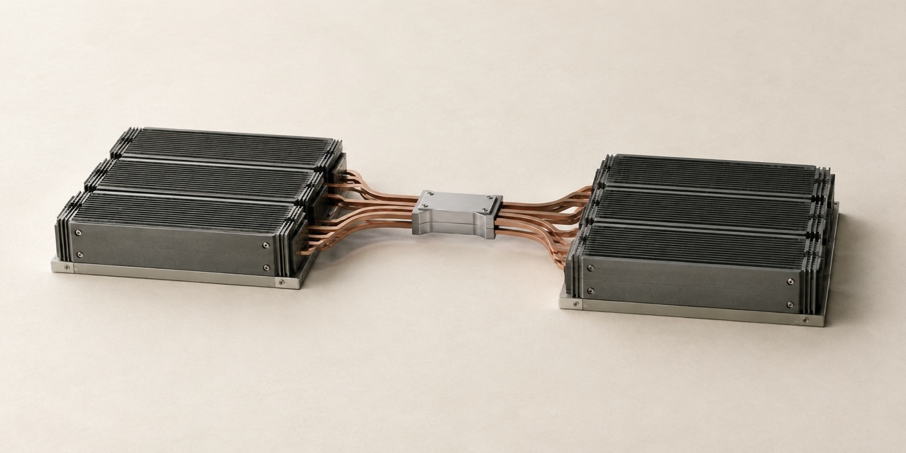

# Cover artwork — network-vs-more-gpus



Unbranded conceptual illustration for this project. These miniature physical models
communicate the subject; they are not engineering diagrams or photographs of deployed hardware.

| File | Use | Dimensions |
| --- | --- | --- |
| [social-preview-v1.jpg](social-preview-v1.jpg) | GitHub social preview | 1280 × 640 |
| [linkedin-v1.jpg](linkedin-v1.jpg) | Website sharing / LinkedIn artwork | 1200 × 627 |
| [cover-v1.png](cover-v1.png) | Full-resolution master | 1774 × 887 |

Both JPEG exports are below 1 MB. The LinkedIn export removes a small amount from
the sides to fit its recommended aspect ratio; the subject is preserved.

## Activate the repository preview

Committing these files does not configure GitHub's social preview.
Open [repository settings](https://github.com/dimaggi-ai/network-vs-more-gpus/settings),
find **Social preview → Edit → Upload an image**, and select `social-preview-v1.jpg`.
See [GitHub's instructions](https://docs.github.com/en/repositories/managing-your-repositorys-settings-and-features/customizing-your-repository/customizing-your-repositorys-social-media-preview).

For a website link, use `linkedin-v1.jpg` as the page's public `og:image`, with
its own title, description and canonical URL. See [LinkedIn's requirements](https://www.linkedin.com/help/linkedin/answer/a521928/making-your-website-shareable-on-linkedin).
Then check a fresh link in [LinkedIn Post Inspector](https://www.linkedin.com/post-inspector/)
and inspect the actual Featured card. Cached or existing cards may need to be re-added.

## Production notes

Created with Codex's built-in image generation tool. Final artwork was visually
reviewed. Exported with macOS `sips` for dimensions and JPEG compression.
No text, logo, author name, date, neon lighting or performance claims appear in the image.

Style reference: None; this image established the series style.

Alt text: Two banks of graphite compute modules joined through a narrow copper interconnect.

### Generation prompt

```text
Use case: stylized-concept.
Asset type: understated editorial cover for an open-source study of GPU cluster networking, to appear as a small GitHub/LinkedIn thumbnail.
Create one finished, original raster illustration, landscape 2:1 aspect ratio, ideally 1280 x 640 pixels. This is visual artwork, with absolutely no text.
Concept: the connection between compute resources determines their usable capacity. An elegant physical engineering maquette on a warm off-white surface: two modest banks of three low-profile accelerator modules, connected across one visibly narrow central interconnect. Six modules total, no sprawling data center. The modules are simplified machined graphite housings with fine parallel cooling fins, not branded hardware. A few carefully spaced flat conductors in muted oxidized copper meet at the narrow passage and emerge on the other side. The interconnect, not a wall of hardware, is the focal point.
Medium: tactile architectural model photographed as a considered editorial still life; precise geometry, matte graphite, brushed pale metal, warm paper-colored background. Broad diffuse daylight, quiet contact shadows, subtle real surface texture, no glossy CGI plastic. Slightly elevated oblique view, generous approximately 40 percent negative space. Complete subject contained in the central 75 percent of the canvas, crop-safe margins.
Palette: warm chalk, charcoal, cool gray, small desaturated copper accent; very low color saturation. At thumbnail scale the two banks and the single constriction must read clearly.
Constraints: no words, labels, numbers, captions, author name, dates, company branding, logos, watermarks, charts, arrows, brains, robots, decorative circuitry, particles, lens flare, bloom, glowing lights, neon, purple/cyan gradients, or futuristic cityscapes. No overcrowding. No generic AI stock-art treatment. Sparse and intellectually clear, with the craftsmanship of a high-quality architecture journal illustration.
```
